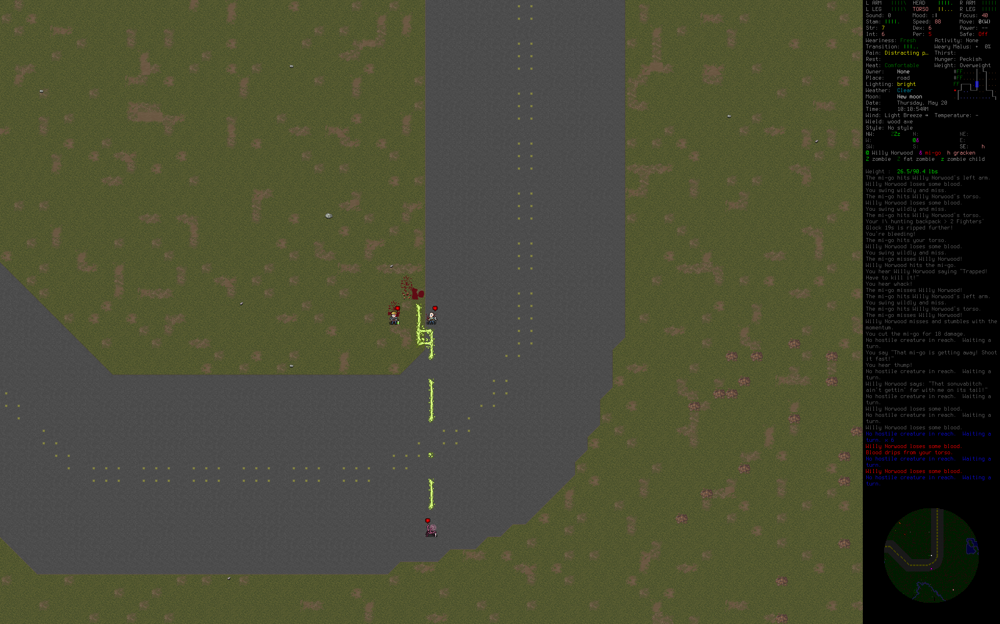

# Cataclysm: Arsenic and Old Lace

A turn-based survival game set in a world that has already ended. Scavenge what you can, make a shelter, find allies and decide how long you can survive the things hunting outside.

<details>
<summary>Enter the Cataclysm</summary>

```text
 @@@@@          @                  @@                       @                                      .--::.-=-=-*+=.
 @   @   @@    @@@    @@@    @@     @@           @@@   @@@                                      .....  .:*#*-:   .
 @         @@   @        @ @@   @   @@   @   @  @     @@@@@@                                  .:..-::..:.::
 @     @@  @@   @    @@  @ @@       @@   @   @   @@@@ @@@@@@                                ==-:-:==:. ..:-+==-*%::--..    .
 @@@@@  @@@@@   @@@  @@@@@  @@@@@   @@   @@@@@  @@@@@ @ @@@@                              -......::--:....::... .-+.   .    ..
                         @@   @@@@@      @@@@@                                           =#=.  .:-=+=::.     .:.
       @@     @@ @@    @@  @@ @@      @@   @@  @@    @@ @@                              :+*#-:..   :-:..     .::.
       @@      @   @@  @      @@      @@@  @@  @@   @@                                   .-=+-=:.     :.      .. ..
       @@      @   @@  @@     @@      @@@  @@  @@  @@                                  ...:::-*%#=:.     .          . .
      @ @@     @   @@  @@@    @@@@@   @@@@ @@  @@  @@                                  .:::--*@@@@%#*-::.
      @ @@     @  @@    @@@   @@      @ @@ @@  @@  @@                                .:.:-:-+%@@@@@@@%%#*+=-:.      ...:--.
     @   @@    @@@        @@  @@      @  @@@@  @@  @@                                : .:---+%@@@@@@@%%%%%%%#=:.::-**+*++==-
     @   @@    @ @@        @@ @@      @  @@@@  @@  @@                                .  :::=*%%@@@@%@@%%%%##%%%###********++=:
    @    @@    @ @@        @@ @@   @  @   @@@  @@  @@                                :  :-:=*%%%@@@@@@%%%#%%%%%%%#######***++-.
    @     @@   @  @@  @@   @  @@  @@  @    @@  @@   @@                               -..::-=*%%%@@@@@%%###%%%%%%%%%%###**++++=:
   @@     @@  @@        @@     @  @   @        @@    @@@@                          #@=:...-*%%@@@@@%%%%%%##%%%%%%%%%%#*****+++=.
                                   @                                              #=-+...=#%%%%#=:-=*#%%%%##########**=-:...-+*+  :--
                        @ @@@@@@@@ @                                              *-*%=.:#%%%*=-::.   .:-=+**##***-:.  .:::--=++.:*+
                        @@ @   @ @@@                                              =+#*+-:#%%#+****+========+***++=--========++++.-*:
        @ @   @@    @@@@      @@       @     @ @@ @@ @                    +#*:    .##-=+=#%%#*++=-***+=:--=+**++=------:---===++:+*.     =%%%=
       @   @  @@    @@ @@     @@       @@   @@    @@                    +@@@@@@-   *%=+%*%%##*+=-:+: .*=---*%#*=---==  :*:.=++++=**    .@@@@@@@.
      @@   @@ @@    @@  @     @@       @@   @     @@                   .@@@@@@@@.   @%*#%%%%%%##%%%#+*%#*#*%@%#*++++##***++++++++*+   .@@@@@@@@=
      @@   @@ @@    @@  @@    @@      @ @  @@     @@@@                  @@@@@@@@@   #%%####%%%%%%%#*+++*#%%@@%#*++*++====++**+++++-   #@@@@@@@@:
      @@   @@ @@    @@  @@    @@      @ @@ @@     @@                  .#@%%@@@@@@@:  :*+=###%%%@@%%####%%@@@@%#**+**********+++=:   :%@@@%%%%%%%+
      @@   @@ @@    @@  @     @@     @@@@@ @@     @@                 #%%%%%%%%@@@@@@+.   =###%%%%%%%%@%%%@@@@%#***+++*****+++++: .*@@@@@%%%%%%%%%%=
      @@   @  @@ @  @@ @      @@  @  @   @@ @@    @@  @             +%###%%%%%%%@%@@@@@#::######%%%%%%%#%%%@@%#*++++++***++===+#@@@@%%%%%%%%%%####*
        @ @   @@@@  @@@       @@@@@ @@   @@  @@@  @@@@@             .%######%%%%%%%%%@@@@@##########****#@@@@%#***+===++======*@%@%%%%%%%%%######%=
                                                                      *#%%#+.    =#%%%%%@@%####**#*++++**+=#%#**=:+*+=========#@%%%%*:     .=###=
                                                                                      *%%%%#####**+++#%%%%%#+::==+++++========*#=
                                                                                          =###**#*##%%%%%%#*+-===++++++======-
                                                                                            -#*###%%#*******+**++==-===+====-
                                                                                             :**###*+--==-::::::::-+--=====.
                                                                                              .***+++***#%####*+++=-=----=.
                                                                                               ++++=++==--::...:--------=
                                                                              .--.        :*%@@@#+****#*%%@%###*+======+@@%+.
                                                                            =@@@@@@@%##%@@@@%%%%%#*+*#%%%%%**#*+++++==#%%@@@@@@%*+*%@@@@@@+
                                                                            @@@@@@@@@@@@@%%%%%%%*.  .+****+==+++===- :#%%%%%%@@@@@@@@@@@@@@+
                                                                            %@@@@@@@@@@@%%%%%=          ..:::-:::.      .+%%%%%%@@@@@@@@@@@=
                                                                             *@@@@@@@@%%%%=                                 =%%%%@@@@@@@@@-
                                                                               *@%@@@%%%+                                     =%%%@@%@@%:
                                                                               *%%%%%%%#                                       =%%%%%%%@.
                                                                               +%####%%                                         #%#%%#%%.
                                                                                =###%#                                           *%###%
```
</details>



## Survive your way

- Explore a sprawling ruined world, from abandoned towns to dangerous wilderness.
- Scavenge food, tools and weapons; craft, build and adapt what you find into a place to survive.
- Manage injuries, hunger, thirst and exhaustion while fighting or avoiding the dead and other threats.
- Meet survivors, recruit companions and encounter hostile groups, including bandits and cannibals. Camps and roaming threats can make the world dangerous beyond a single encounter.
- Use vehicles, skills and a huge range of items to make your own plans in a deeply simulated, turn-based sandbox.
- Optionally connect an LLM for free-text NPC dialogue and a limited set of follower actions. The game remains a survival game without it.

C-AOL is an **alpha in active development**. Features and balance can change, and behavior may vary between builds and branches.

## Get started

See the [setup and build guide](doc/SETUP.md) for source builds, platform documentation and optional LLM configuration. Check [GitHub releases](https://github.com/josihosi/Cataclysm-AOL/releases) for available packaged builds; availability and contents vary by release. Keep a separate backup of saves and configuration before changing versions.

At the main menu, choose **World → Create World** to begin. The **Special** menu includes a tutorial, though it may lag behind the fork. Press `?` in game to see commands and key bindings.

[Watch gameplay](https://youtu.be/HfishtPzvhA)

## Roots and contributions

C-AOL is a fork of [Cataclysm: Dark Days Ahead](https://github.com/CleverRaven/Cataclysm-DDA) and [Cataclysm-TLG](https://github.com/Cataclysm-TLG/Cataclysm-TLG). Thank you to their maintainers and contributors for the game and community this project builds on.

Bug reports and play experiences are welcome. If reporting an LLM issue, the optional LLM debug log can help; review it for private content before sharing.
