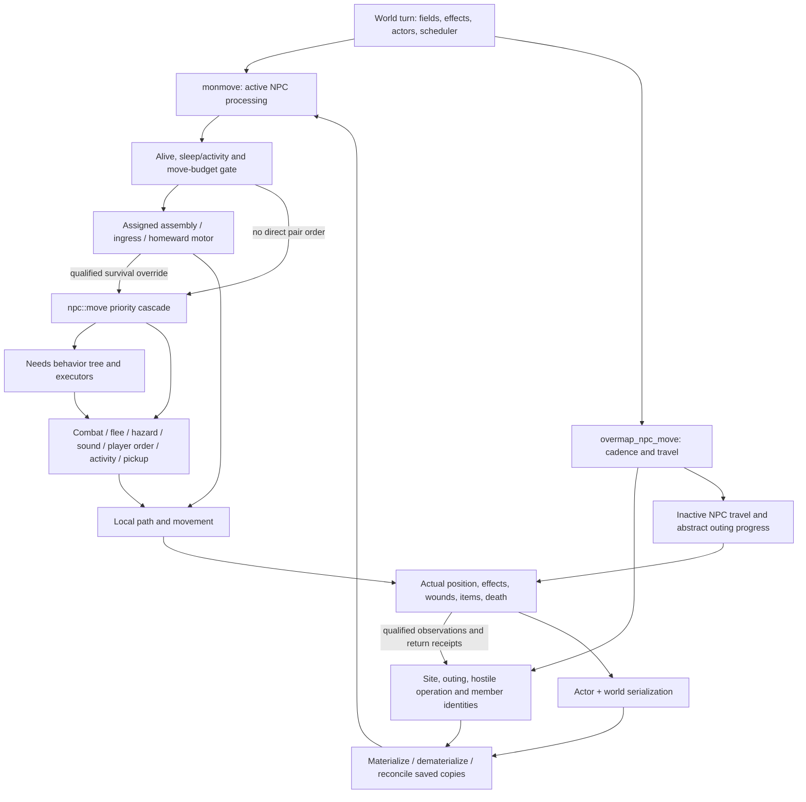

# NPC AI: who controls what

Source review, 2026-10-02. This is a navigation and diagnosis map of the current **working tree**, not an alternative gameplay specification or a claim that every interaction is tested. The source hashes and test-name index are in `.de67/task-logs/npc-ai-review-20261002/inventory.json`. Re-find symbols after source changes; line numbers below are landmarks.

Start here, then read [handover and encounter tests](npc-ai-interaction-tests.md). Existing FS requirements and accepted evidence retain their authority. In particular, do not rerun completed setup, erase interrupted runs, or diagnose a bug from an absent action row alone.

## What the code actually contains

There is no single NPC state machine. `mission`, player-facing `attitude`, an activity, a needs commitment, local and overmap destinations, group membership, and simulation ownership are different pieces of state. Several can coexist. The first diagnostic question is **which caller selected this actor's action this turn?** A group order is not evidence that the ordinary NPC decision function ran.

The arrows summarize callers, not a proposed rewrite. Not every local action passes through `npc::move`; not every inactive actor belongs to an abstract outing. Companion missions are another representation and are deliberately excluded from ordinary local loading.

## Smoke sensing correction — specification, implementation pending

The [FIRST-SMOKE contract](../.de67/FS.md) now explicitly represents rising smoke separately from its emitter. Current `adapt_local_field_signal_reading` produces reach from fire/gas strength, persistence and weather; `observe_loaded_z_light_sources` retains the original `source_ms`. Camp same-z smoke admission uses overmap reach/LOS, whereas stationary `site_reader::read_signal` calls the generic interior-target reader. This is the demonstrated integration gap, not evidence that adding scout vision changed gas propagation. R020 really reached assault using prewatch7799; R058's later fresh typed-watch requirement is retained.

Implementation belongs to the existing source owner: reconcile this producer → current representation → camp/travel/watch consumers → typed witness → carrier/report chain for both factions. An ordinary above-ground building may supply a modeled external plume under the scoped FS abstraction; no universal through-wall actor/light vision, arbitrary height, or old lead as fresh evidence. Underground/established sealed and unavailable-geometry cases retain the FS exposure limits. Keep actual emitter z/source/sample and observed component/observer provenance distinct. [Review directive and evidence](../.de67/task-logs/review-owner-3a14f26560f6/coordinator-directive.md) bind the required correction and four parallel fullINITIAL journeys. No source implementation or native adoption is claimed by this map update.

## Primitive inventory

| Surface | Implemented owner and source | Meaning, interruption and recovery |
|---|---|---|
| World scheduling | `monmove`, `overmap_npc_move`, [do_turn.cpp](../src/do_turn.cpp) | Active actor effects/actions and strategic cadences differ. Signals are sampled on a five-minute cadence, dispatch on thirty, structural maintenance hourly. An arbitrary five-minute wait is not proof that an hourly consumer refused work. |
| Group plan | `site_record`, `active_outing_state`, `hostile_operation_state`, [bandit_live_world.h](../src/bandit_live_world.h) | Exact member IDs, shared route, phase, observation/cargo, casualties, resolved members, return receipts. A route cursor is not a physical group centroid. `actor_route_waypoint` separately records actual arrival. |
| Simulation ownership | `simulation_owner`, crossing/handoff records and projection lease; `transition_external_simulation_owner`, [bandit_live_world.cpp](../src/bandit_live_world.cpp) | Authority to advance an operation, with generation/epoch/cursor validation. Distinct from an NPC being active in the creature tracker. Rejected ownership does not by itself explain the original divergence. |
| Local admission | `game::load_npcs`, `unload_npcs`, [game.cpp](../src/game.cpp) around1187 | Uses persistent NPC identities and active tracker membership; skips companion missions and abstract-owned scouts. Paired admission has its own producer. Unloading clears active tracking; `npc::on_unload` is empty. |
| Inactive movement | `overmap_npc_move`; `npc::travel_overmap`, [npc.cpp](../src/npc.cpp) around1556 | OMT movement updates the concrete NPC's position; generic `spawn_at_omt` chooses a square inside the OMT. Specialized paired travel can retain offsets. This is not tile-by-tile combat simulation. |
| Load catch-up | `npc::on_load`, [npc.cpp](../src/npc.cpp) around4253 | Body/effect/focus updates, capped at two days and using coarse intervals, plus activity moves and schedule reconciliation. It does not replay every unseen encounter. Existing load-equivalence tests are hidden-tagged, not automatic proof of all NPC behavior. |
| Attitude and mission | `npc_attitude`, `npc_mission`, [npc.h](../src/npc.h) | Attitude primarily describes relation to player; mission describes travelling/guard/activity/camp/shop roles. Neither alone identifies current motor, target, or group authority. `previous_*` supports activity restoration. |
| Perception and threat | `regen_ai_cache`, `assess_danger`, `act_on_danger_assessment`, [npcmove.cpp](../src/npcmove.cpp); `attitude_to`, [npc.cpp](../src/npc.cpp); `handle_sound`, [npctalk.cpp](../src/npctalk.cpp) | Local visibility, faction/engagement rules, targets, sound alerts, friend/enemy estimates, panic and repositioning. Different monster species often enter shared paths; special attacks, fields, reach, movement and effects require capability-specific tests. |
| Scout site knowledge | Stationary optical/signal adapters in [do_turn.cpp](../src/do_turn.cpp), [scout_observation.cpp](../src/scout_observation.cpp); assessment/report reduction in [bandit_live_world.cpp](../src/bandit_live_world.cpp) | Target-local binocular observations are a separate, scoped knowledge path, not expanded combat sight. Current source passes the indoor smoke emitter to the generic optical reader and can reject it as `interior_unknown` despite camp admission. Review3a14 requires a shared current smoke representation with distinct emitter and exterior rising-plume support; this is the approved FS target, **not implemented source behavior**. Individual/private evidence, received evidence and delivered camp knowledge remain distinct; fresh R058 watch provenance stays. |
| Ordinary action selection | `npc::move`, [npcmove.cpp](../src/npcmove.cpp) around2761 | Ordered C++ branches surround the behavior tree. Early returns matter. It reconciles assault routine, reads danger, handles special activities and optional LLM intent, then hazards/combat/needs and fallbacks. |
| Needs choice | [npc_behavior.json](../data/json/npcs/npc_behavior.json), [character_oracle.cpp](../src/character_oracle.cpp), `execute_need_goal` | Utility/fallback tree plus C++ legacy `address_needs`. Food, water, warmth, sleep executors return progressed/satisfied/holding/deferred/blocked/impossible. Repeated blocked targets can be abandoned; these outcomes are not group completion receipts. |
| Sleep and incapacity | `Creature::in_sleep_state`, [creature.cpp](../src/creature.cpp) around2416; `Character::in_sleep_state`, [character.cpp](../src/character.cpp) around5552; [player_hardcoded_effects.cpp](../src/player_hardcoded_effects.cpp) | Sleep, lying down and NPC suspension enter the sleep-state gate; `ACT_TRY_SLEEP` also does. Stun/downed/narcosis and movement restrictions have additional consumers. Voluntary sleep selection, ongoing sleep, forced collapse and ability to move are not interchangeable. Owner amendment2026-10-06 now requires current active operation duty to interrupt ordinary sleep before scheduler exclusion and suppress routine sleep selection, including outbound and homeward travel, stalking, robbery, raid and Fight. This is the pending implementation contract in FIRST-SMOKE-S001, not proof that existing assault-only or alarm controls deliver it. Forced incapacity and actual released-member rest remain separate. |
| Robbery demand → audible wake → responsive receiver | `do_turn.cpp::live_bandit_establish_shakedown_communication`, `sounds.cpp::process_sound_markers`, real effect/scheduler admission | Owner-scoped refreeze2026-10-06: an actual robbery demand wakes all nearby ordinary-sleeping NPCs that hear it, including nonmembers and heavy sleepers; forced incapacity remains. Current source filters asleep NPC receivers before shouting and generic sound wake is random. Emit without circular awake-receiver prerequisite; reconcile wake before actual contact, with bounded same-operation emission across load/callbacks. Wake does not establish payer eligibility, target knowledge or hostility. FIRST-SMOKE-S001 and encounter spec are normative; implementation/native adoption pending. |
| Duty and work hours | `npc::reconcile_schedule`, `reconcile_active_assault_routine`; camp patrol runtime | Scheduled class work hours, camp patrol and hostile assault are distinct mechanisms. Schedule reconciliation can clear sleep/suspension; assault reconciliation runs once per operation and preserves listed incapacitation conditions. No universal faction sleep rule can be inferred from either. |
| Combat and retreat | `method_of_attack`, `evaluate_best_attack`, `method_of_fleeing`, `execute_action`, [npcmove.cpp](../src/npcmove.cpp), [npc_attack.cpp](../src/npc_attack.cpp) | Native target selection, attack evaluation, aim/reload/friendly-fire handling and movement. Panic can mean tactical repositioning or flight. Hostile withdrawal can own the route home while preserving selected immediate survival overrides. Damage/death attribution is separate from chosen action. |
| Fire and other hazards | `sees_dangerous_field`, `good_escape_direction`, `escape_explosion`, `move_to`, [npcmove.cpp](../src/npcmove.cpp); map field/effect processing | Fire escape is an early ordinary-action branch; explosion avoidance follows. Direct pair motors have their own constraints and homeward hazard path. Validate each motor rather than assuming ordinary hazard priority applies everywhere. |
| Navigation | `update_path`, `go_to_omt_destination`, `move_to_next`, `move_to`, [npcmove.cpp](../src/npcmove.cpp); `map::route` | Separate OMT goal/path and local tile path. Doors, occupancy, avoidance, vertical terrain, flags and move effects can invalidate a previously computed route. Some refusals pause without a typed result; an empty route has multiple meanings. |
| Loot and equipment | `find_item`, `pick_up_item`, `scan_new_items`, `wield_better_weapon`, [npcmove.cpp](../src/npcmove.cpp) | Ordinary pickup searches within six tiles with visibility/ownership/rules/capacity checks, then revalidates. Targeted LLM pickup and need-driven food/water are separate entry points. Fetching an item can compete with follow/activity/travel fallbacks. |
| Activities and jobs | `do_player_activity`, `find_job_to_perform`, `worker_downtime`; [activity_actor.cpp](../src/activity_actor.cpp), [activity_handlers.cpp](../src/activity_handlers.cpp) | Current activity, destination activity, stashed activity and backlog; camp job priorities/cooldowns. Completion reverts mission/attitude. Forage/harvest has special danger cancellation; operation/spellcasting has an earlier dedicated branch. Do not generalize one activity's interruption policy to all. |
| Player interaction | `address_player`, `mug_player`, dialogue/talk functions; shakedown consumer | Talking, leading, following, waiting for departure, mugging and formal Pay/Fight operation are distinct. Peaceful contact must not be mistaken for committed combat merely because camp/faction is hostile. |
| Optional LLM control | `llm_intent_state`, `apply_llm_intent_target`, `execute_llm_intent_action`, `apply_llm_intent_item_targets` | Pending responses, queued actions, target grace, forced panic and targeted items alter the native cascade when enabled. This review leaves the in-game LLM snapshot unchanged. |
| Persistence | [savegame_json.cpp](../src/savegame_json.cpp) NPC/Character load/store; [game_io.cpp](../src/game_io.cpp) projection reconciliation | Persistent actor fields/effects and world owner state coexist with transient caches/plans. Test actual serializers and reconciliation, not a hand-built post-load state with already-aligned cursors. |

## Bandit encounter intent: approved target contract

[Bandit visits specification](npc-bandit-encounter-spec.md) separates visit intent, individual survival, communication and simulation ownership. It is normative target behavior; implementation/native proof must be recorded separately below. In particular, peaceful approach does not disable self-defense, camp-NPC contact may drive remote UI, and overmap-only visits wait for local simulation. Keep this contract in one place rather than adding competing rules to each handoff.

## Actual priority is caller-dependent

**Active actor:** `monmove` applies fields, runs `process_turn` unless suspended, then checks death, sleep-state, moves and loop bounds. Selected pair motors refresh threat cache. Current top-level pair survival predicate checks flee attitudes or a current target with positive danger; assembly/ingress/homeward branches otherwise take control. Homeward has further explicit hazard/threat/reunion checks. Other actors fall through to `npc::move`.

**Ordinary `npc::move`:** operation/spellcasting and safe forage/harvest have early activity handling. Optional pending LLM responses can pause before the later fire/explosion branches. Ordinary immediate hazard escape, hostile withdrawal, vehicle danger, fear, asthma and combat precede assault search and ordinary needs. Quiet behavior then combines tree choice, need executor, legacy needs, player interaction, guard/goto, follow/embark, activities, camp work, equipment/pickup and long-term travel. Read the actual branch for the actor; this paragraph is not a new total-priority contract.

**Inactive actor:** neither an absent local action trace nor a local `mission` proves it is stuck. Inspect the current persistent identity, owner, `is_active`, next OMT motor and cadence. Inactive movement does not imply full off-screen fire/combat simulation. Conversely, an outing tagged `owner=local` can include inactive concrete members; that combination is not automatically corrupt.

## Handover contracts to inspect

| Boundary | Producer → receiver assumption | Existing result/recovery; decisive evidence |
|---|---|---|
| Dispatch → travel | Scheduler reserves exact living/ready IDs; every member needs an admissible origin and route | Candidate route from camp anchor is insufficient proof of member routes. Preserve rejected candidates. Compare each origin/goal/path, not just shared route. R052 addressed one actual mismatch. |
| Abstract → local | Materializer binds the whole admitted party to real available entry/staging positions | `materialize_live_bandit_structural_handoffs` plus crossing/lease writers; R059 protects assembly from stale generic travel. Record before/after copies and actual positions. |
| Group motor → survival | Chosen local motor must yield under its implemented threat/hazard conditions | R060 verifies flee/target priority for a focused path. Fire-only, explosion-only and non-attitude panic are separate candidate tests, not covered by that statement. |
| Survival → group | Once safe/capable, a still-valid assignment must regain a reachable route or report a meaningful inability | R055 reunion permits detours; R060 supplies an inactive homeward writer. Do not clear wounds/fear or teleport the partner merely to restore cohesion. |
| Movement → watch | Exact physical member arrival and route cursor must agree before finite assessment | R057 repaired this; retain actual producer-to-consumer test. A destination assignment alone is not arrival. |
| Watch → evidence | Capable, stationary assigned observers acquire current facts through actual adapters | R056/R058; distinguish old lead, fresh signal bucket, target-local exterior sight and unseen interior. Interruption stops acquisition rather than inventing a completed watch. |
| Watch interruption → recovery/return | Keep actual interruption location/cause and distinguish it from completed no-activity; current danger/capability and route remain authoritative | Published source remembers the interrupted lookout and cause, qualifies current different lookouts with both member routes, and preserves honest reports. Routine scout eligibility governs interrupted-report recovery. Source controls pass; coherent host products and native use remain pending. [Source handoff](../build_logs/first-smoke-067/interrupted-watch-report/publication/handoff.md). |
| Partial unloading/reload → resumed owner | Persistent actor copies, operation generation/epoch and cursor remain coherent | R054 clock synchronization and negative identity/copy tests; active/inactive motor paths must be tested too. A validator passing does not prove a next motor exists. |
| Return → report → decision | Physical returned carriers and evidence reduce once, then scheduled camp decision consumes report | Per-member return/application keys and hourly scheduler. Test the due boundary. R058 disproved the earlier premature no-report diagnosis. |
| Decision → contact/withdrawal | Reservation/capability, route and concrete contact actors agree | Peaceful shakedown, Fight and cannibal assault have different consumers. Actual survival may end an operation legitimately; require attributed actions/damage instead of demanding victory. |

## Established facts and remaining risks

R061 exercised the first proposed sequences. Exact results, fixture limitations, original failures and source-bound binaries: [R061 result](../build_logs/first-smoke-061/result.md). Its receipt is a checkpoint, not whole-claim completion.

| Condition | Established behavior | Evidence and limit |
|---|---|---|
| Actual dispatch, brute pressure/flight, temporary blocked partner, partial unload, real save/load, then safe conditions | Both faction variants preserve identities/wounds/leases and physically resume/reunite | Combined production sequence at `tests/bandit_live_world_test.cpp` R061. This does not yet prove home delivery/report. Declared threat and ready roster are automated setup. |
| Lying down with critical thirst | Direct `npc::move` drinks; scheduler processes lying down into sleep and does not drink within five turns | R061 sleep scheduler tests. The original direct-call test does not prove scheduler delivery; intended wake policy remains a separate question. |
| Ordinary sleep versus narcosis under a real threat | Ordinary sleep wakes after injury; narcosis retains sleep | Bounded scheduler control. Suspension, stun and downed follow distinct paths; do not generalize to faction-wide duty. |
| Perceived player melee against a tired ordinary thug | Selected actions are destination/pause, not Sleep, over five turns; narcosis remains asleep | This does not reproduce sleeping during camp defense, nor prove effective retaliation, camp alarm or night scheduling. Owner complaint remains open. |
| Saved8640 returning pair inside map but five submaps from player | The repaired common `game::load_npcs(map*)` queries the receiving map's full extent. Both actors physically move with the player fixed and resume after real save/load; overmap still defers them to the local motor | **Reproduced and repaired coverage defect**, both faction variants. [R061 repair and old-product counter](../build_logs/first-smoke-061/resumed/result.md), source `ace47596`, tests `[homeward_motor_coverage_061]` and `[local_admission_061]`. Original radius4 stall/counterfactual retained there. Fixture omits ambient monsters/other actors/avatar health; native home/report remains unproved. |
| Native same-ID return on immutable R061 after receiving-map repair | Ordinary saved8675 acknowledges pending crossing; subsequent native IDs4/5 arrive home8685 (seq37/38), report secured for return8700 (seq63) | [Checkpoint53 with exact native handles](../build_logs/first-smoke-061/resumed/r051-q1-checkpoint-20261002.md). Final carrier delivery/demand still unproved. Saved8700 launch later stopped at character chooser before World; selected-build readiness is repaired. Adjacent cross-OMT actors are not evidence of flight/splitting. |
| Finite camp/party alarm reaches ordinary sleeper before scheduler admission | R062 source repair wakes and physically moves eligible patrol residents and generated bandit/cannibal home/party recipients; heard incident is not unseen enemy tracking | [Condition/caller/test facts](../build_logs/first-smoke-062/resumed/condition-behavior-caller-facts.json), productb680bc6c/executablec402006c, [accepted source delivery](../.de67/task-logs/r062-source-acceptance.md). Hearing/membership, expiry/reload, forced incapacity, native flight and peaceful-contact controls retained. Native night alarm/camp attack not yet run. |

Remaining source-order risks: direct assembly/ingress hazard handling versus the ordinary hazard cascade; optional pending LLM response pausing before fire/explosion handling; scheduled wake versus genuinely forced incapacity. Reproduce the relevant caller before changing behavior. R061 narrows sleep claims but does not settle these other paths.

Action traces, homeward motor traces, group transitions and saved/current state remain separate evidence surfaces. Join existing facts by identity and time before adding fields. The accepted repairs and the R061 loading counterexample demonstrate why tests must check **actual progress or explicit recoverable refusal**, not only internally consistent state.

R063 source delivery is accepted: the retained normal report8700 at8760 passes bandit333 authorization, actual party4/6, reserve and route. At scheduler8820, the existing transaction now registers an exact zero-valued report-bound claim and commits the shakedown together. Conflicting/consumed records, failed application and replay controls preserve state. Cannibal600 remains unchanged. Schema9 terrain scouting uses the existing physical route, outer-arrival and return machinery; its finite completion reason survives real save/cleanup/load. Final43 cases/42,507 assertions pass on immutable executable e054e957/source f9af3c6c. [Delivery, callers and limits](../build_logs/first-smoke-063/result.md), [original checkpoint counterexamples](../build_logs/first-smoke-063/quiet-review-checkpoint/result.md). The report's latest optical expiry8370 predates delivery8700, so it does not prove lost valid signal eligibility. Controlled production terrain and reload tests do not establish native retained-map movement, demand/payment or night response; those remain with the separate12035 and fresh8760 Luna continuations.

R064 reproduces the native12120 boundary on retained terrain: both active scouts receive120 motor calls in60 turns, but the selector chose adjacent exits in different OMTs while the crossing consumer required one OMT. Canonical frontier selection now honors that existing requirement; actual one-tile crossing consumes the route prefix, including real reload and survival/partial-member controls. Clean old3/904 failures become904 passing assertions; final45 cases/46,685 assertions pass on immutable78f37697/source1a140384. [Exact caller, retained scene and limits](../build_logs/first-smoke-064/result.md). Native R051 continuation now proves crossing, physical outer arrival at12165, same-ID home receipts at12230 and generation2 report/application saved at12360. The report has no sensory observations or cargo. Separate shakedown contact is unresolved. Zero earlier native trace rows did not establish a skipped scheduler.

## Growing this knowledge base

The coordinator maintains this map and the companion test plan as current shared knowledge, with source/test workers supplying exact findings and Luna supplying native evidence. Carry the relevant entry and its limits into each affected worker brief; do not make every worker read the whole map.

Turn useful results into compact entries: **condition → observed behavior → controlling caller/owner → source/build and test or native evidence → limitation**. Distinguish source inspection, reproduced behavior, suspected risk and owner design choice. A passing component test does not prove its scheduler or handover; a native observation does not prove every equivalent-looking case.

Replace the affected explanation when better evidence or code changes it. Retain original runs and receipts by link, not by appending contradictory history to the current map. Reuse or extend the nearest existing regression; a new creature, incident or worker does not automatically need another page or rule. Add an interaction only when it exercises a different control path, assumption or recovery condition.

When changing AI, inspect the relevant map entry and its linked regression to identify likely cross-layer consequences. Refresh affected facts and links as part of that work; do not revalidate unchanged knowledge wholesale. Failed predictions are valuable: record which assumption failed, establish the smallest reproduction, and update the explanation after resolving it. Unresolved behavior stays visibly unresolved.

Keep the map as the concise index, the test plan as actionable coverage and gaps, the FS as intended behavior, and task artifacts as detailed evidence. No duplicate specification, mandatory audit pass, fixed number of entries or new completion gate. Knowledge growth should make the next decision easier, not enlarge every worker's context.

## Research used, and limits

[Mars and Chanut, Game AI Pro 2 chapter20 §§20.3–20.5](https://www.gameaipro.com/GameAIPro2/GameAIPro2_Chapter20_Hierarchical_Architecture_for_Group_Navigation_Behaviors.pdf) separates decisions, pathfinding, navigation and movement, and stresses member capabilities and group footprint in route planning. Here that suggests inspecting member-specific origins/capacity and interruptible route execution; it does not require implementing their hierarchy.

[Anthony Francis, Overcoming Pitfalls in Behavior Tree Design](https://www.gameaipro.com/GameAIPro3/GameAIPro3_Chapter09_Overcoming_Pitfalls_in_Behavior_Tree_Design.pdf) warns against needless organizing types, premature control languages and mandatory blackboard routing. This review therefore reuses existing entry points, tests and trace channels.

Coverage is broad at the control-surface level, with deeper inspection of the NPC cascade, needs/sleep, pickup, active/inactive movement and recent faction handovers. Every dialogue EOC, activity actor, monster special attack, mutation/bionic, vehicle edge, companion mission and mod permutation has **not** been exhaustively audited. The adjacent test plan routes these by the mechanism they exercise and names where more source inspection is needed. No new product behavior or performance saving is claimed.

### Scout threat decisions — owner clarification, 2026-10-14

**Desired behavior, not implementation acceptance.** The existing [FS interrupted-scouting and proportionate-alarm contract](../.de67/FS.md) governs both bandit and cannibal scouts. A creature encounter must not erase the mission. Remain at the current lookout and watch when actual perceived danger and capability permit. If watching there is unsafe, use a different valid stalking OMT for the same target **only through a safe route that does not lead toward known threats**. Qualify the route as well as the destination; a reachable endpoint or a path through ordinary terrain is not proof of safety relative to a perceived threat. If no safe lookout/route is available, use ordinary homeward handling, retaining earned knowledge and an honest interrupted result. A still-valid original lookout may resume when safety returns, as the FS already permits. Real combat, immediate escape, hazards and incapacity take priority; returning home is an intent, not permission to force an unsafe step.

| Decision owner | Existing entry points and responsibility |
| --- | --- |
| Perception and tactical response | `npc::regen_ai_cache`, `assess_danger` and `act_on_danger_assessment` in [npcmove.cpp](../src/npcmove.cpp), plus `npc::faction_alarm_requires_response` in [npc.cpp](../src/npc.cpp), own ordinary combat/escape and credible received incidents. Base interruption on actual scout vision, attacks, credible approach or received danger, not omniscient creature presence or hostile attitude alone. Missing hostile ambient/geometry is not a confirmed sighting and is not proof of safety; it must not erase a justified received alarm either. Scout target optics do not enlarge combat vision. |
| Watch eligibility and evidence | `watch_position_safe_impl` / `watching_member_impl` in [scout_observation.cpp](../src/scout_observation.cpp), consumed by local assessment and structural observer readers in [do_turn.cpp](../src/do_turn.cpp), qualify the actual observer. Keep target-observation validity separate from whether a tactical response prevents watching. When safe and capable, continue the mission without gratuitous relocation or interruption. |
| Alternate lookout and physical route | `advance_live_bandit_local_scout_assessments` supplies member-route checks to `live_bandit_structural_route_read`; `refresh_interrupted_scout_watch_route` in [bandit_live_world.cpp](../src/bandit_live_world.cpp) commits the existing alternate/resume decision. `live_bandit_member_route_to` and the native pair/cohesion motors in [do_turn.cpp](../src/do_turn.cpp) supply and execute routes. Reuse these boundaries to account for known threats along the approach, not just lookout geometry; current threat-relative route safety remains to be demonstrated. No new threat manager, guaranteed alternate or forced fight is selected. |
| No safe continuation | The local assessment caller already connects `abort_local_pair_alternate_watch_reposition` to `live_bandit_route_member_home`. Existing outing/cursor transactions, body executors and carrier/report handling own withdrawal and settlement. Preserve actor identities, casualties, prior observations and one responsible executor through loaded/unloaded transitions. Interruption/travel earns no watch time or invented observations; completed assessment must not be erased by later return safety. |

**Current source and evidence ceiling — cycle24.** The earlier coarse-hostile/unknown-geometry refusals remain historical evidence in [combined-scout-followthrough.current.json](../.de67/task-logs/harness-approval-simplification-20261009/combined-scout-followthrough.current.json). Current `npc::faction_alarm_requires_response` calls `scouting_creature_requires_response`, distinguishing native behavior, approach and real reach/capability while retaining received-attack, flight, hazard and unavailable-incident conservatism. Do not repeat the obsolete claim that every visible hostile unconditionally interrupts. This source read is not whole-mission acceptance: connect watch eligibility, motor, interruption and recovery and verify representative non-immediate warning versus genuine ranged/approaching danger, safe alternate/resumption and honest withdrawal. Unknown received incidents are not certified harmless. The FS carries the selected outcome; historical diagnosis-first tactics and cancelled full-round sequences do not create current holds or rerun obligations.

### Interrupted scouting and alarm recovery — Review288, 2026-10-08

Scouts who returned before watching previously received the same two-day report hold as scouts who completed an empty watch. The report retained honest no-readiness. The corrected production-admitted comparison demonstrates this old behavior for both factions; the original failed route fixtures remain historical evidence. The animal and writer that caused the original return remain unknown.

Published source now stores a bounded interruption inside the existing assessment, separately from optical observations. It retains lookout, known cause and interruption/recovery time. Current safety and geography qualification prefer a different suitable lookout with routes for both scouts. A safe original lookout is a fallback when no suitable different one exists. A later interruption is a new recovery episode. Fresh fallback clears an invalid cached alternate while preserving the ordinary no-progress limit. Earlier sightings remain reportable and do not supply resumed-segment watching time or readiness.

The alarm remains finite and authenticated. `npc::faction_alarm_requires_response` retains genuine hostile perception, dangerous fields, flight and uncertainty about a received incident. An active source must establish incident clearance before resuming a watch. Published source7ded8795 also allows an authenticated returning scout to disengage through the existing native home route while retaining a credible warning. Current ownership, capability, perceived threats, next-step hazards and pair cohesion qualify each step; refusal preserves the prior Pause/investigation response. The shared native route preparation checks validated cached endpoints against the current waypoint and replans stale paths. Movement does not mint an assessment, report or return receipt. `npc::assess_danger` treats neutral creatures as neutral for structural scouts. Absence of an attack alone does not establish safety.

Actual producer and consumer entrypoints are `remember_scout_watch_interruption`, `advance_live_bandit_local_scout_assessments`, `refresh_interrupted_scout_watch_route`, `advance_structural_scout_assessment` and `resolve_response_authorization_denial`. Returned interrupted or unstarted reports use existing routine scout capability, age-adjusted risk and cooldown. Completed empty watches retain their existing report policy. Physical return, carrier identity and ordinary new-outing admission remain effective.

Source/control review is settled on published commit `f50dd4214bf38f76955e6ceb30a64efca339deda`. [Publication and caller handoff](../build_logs/first-smoke-067/interrupted-watch-report/publication/handoff.md) binds the implementation and preserved runtime ancestry. [Coordinator review](../build_logs/first-smoke-067/interrupted-watch-report/implementation/coordinator-review.json) records the corrected production gaps. The broad preview passed five cases with 2446 assertions; the final cache correction passed two affected cases with 1644 assertions. Both hosts subsequently adopted f50 and later reviewed descendants. The earlier source controls retain their scope; they do not establish the historical interruption cause. Current native evidence and the remaining assessment boundary are described below.

Current homeward alarm correction is published as `7ded8795b36b0a5770c28a4e37bec57b0ae4f49e`, retaining f50/c43 gameplay and27483081 controller ancestry. [Source and caller handoff](../build_logs/first-smoke-067/current-scout-alarm-8355/publication/host-handoff.md) binds actual scheduler controls for both factions, stale paths and stepwise trap/field refusal:33308 assertions plus380 downstream controls pass. The identical existing clipped-map precondition failures remain a limit. Both hosts adopted this source and later reviewed descendants; the later b93 continuation proved physical home and carrier reports. The copied scene does not establish the historical alarm cause or whole-home safety.

Published cohesion source `b93e64f7` extends the existing validated homeward rendezvous to safe ordinary or boundary steps refused for pair cohesion. One actor holds while a qualified mover advances inward; separated-pair detours remain. Both current leases, home/egress orders, actual configured distance, occupancy/fields, known traps and non-reentry qualify the route. Flight, genuine alarms, hazards and incapacity keep precedence. A qualified cached inward endpoint is refreshed through native `map::route` before its result is consumed once; cached avoidance alone does not prove terrain or edge legality. No stored regroup mode or new radius exists. [Source handoff and controls](../build_logs/first-smoke-067/pair-cohesion-5556981/publication/host-handoff.md) retain four cases/20,754 passing assertions, the preceding24 changed-wall failures and22 inherited enclosing failures. The original saved b93 continuation subsequently proved same-pair physical home and carrier frontier reports, with an honest later danger-interrupted outing. [Native preservation receipt](../.de67/task-logs/R-MAINT-SCENARIO-CONSOLIDATION-mac-capacity-001/saved-homeward-cohesion-b93-native/coordinator-preservation-ingress-receipt.json) binds saved6075535 and normal game exit. Smoke assessment, payment and later reload remain open; reconstructed controls do not prove historical causation or whole-route safety.

### Completed assessment versus return safety — Review62b5, 2026-10-09

On published247bf0ea, scouts5/6 completed a smoke-founded watch at8040, physically returned at8060 and delivered report8100. The cohesion-abort caller then invoked `remember_current_scout_interruption`, clearing readiness and replacing the completed result. A prior run on the same source retained its completed smoke assessment. This proves a result-ownership defect, not a universal smoke failure, new regression or invalid cohesion decision. The exact physical cohesion trigger remains unknown.

[Review and original-source verification](../.de67/task-logs/review-owner-62b5c7abaeb1/review.md) direct the existing source owner to preserve acquired assessment through homeward safety while retaining genuine unfinished interruptions, freshness, casualties and physical-carrier reporting. Phase or readiness alone cannot distinguish completion because unfinished alternate/casualty paths also enter return. The published02389e02 correction bounds both interruption callers with the existing outbound/searching/observing acquisition phases; returning safety cannot open a new watch interruption. Finite report reconciliation excludes active or pending interruption. Original identical-fixture control fails40/942 assertions; revised connected group passes6 cases4864 assertions. Actual normal homeward service establishes its clock, and later timeout preserves it. Unsupported structural assembling admission was removed. [Final material review receipt](../.de67/task-logs/completed-assessment-return-safety-ingress/clock-review/coordinator-ingress-receipt.json) binds the exact source and controls. [Publication receipt](../.de67/task-logs/completed-assessment-return-safety-ingress/publication/coordinator-ingress-receipt.json) verifies the exact reviewed committed bytes. Coherent Mac game/test adoption passes the same6/4864 connected controls and9/409 registered-world controls, with normal build/test exits. [Mac product receipt](../.de67/task-logs/R-MAINT-SCENARIO-CONSOLIDATION-mac-capacity-001/common-completed-return-safety-02389e02/coordinator-ingress-receipt.json) binds actual products. The fresh native journey on02389e02 retained the completed smoke assessment through return and delivered the meaningful report at8340 through the original Luna. [Native report receipt](../.de67/task-logs/R-MAINT-SCENARIO-CONSOLIDATION-mac-capacity-001/common-completed-return-safety-02389e02/fullinitial-roof-payment3-native/coordinator-ingress-receipt.json) binds the same scouts, acquired observations and complete protected save5257010. The later unpaid Trade exposed unowned floor goods excluded from selection; no payment occurred. [Closeout receipt](../.de67/task-logs/R-MAINT-SCENARIO-CONSOLIDATION-mac-capacity-001/common-completed-return-safety-02389e02/unpaid-trade-closure-owned-basket-5257010/coordinator-ingress-receipt.json) verifies native save5258403, normal exit, accepted partial report and exact current-process closure. Payment, goods home, release and repeated native reload remain open. The failed serialized report remains unchanged. [Preservation receipt](../.de67/task-logs/R-MAINT-SCENARIO-CONSOLIDATION-mac-capacity-001/common-alarm-save-247bf0ea/fullinitial-roof-payment2-native/review62b5-preservation-closeout/coordinator-ingress-receipt.json) proves full native save5270528, normal exit and current-group cleanup; it does not prove payment, goods return, release or reload.

### Encounter payment source eligibility — 2026-10-09

On02389e02, the active demand pool in `do_turn.cpp` counts local inventory, allied, ground and cargo goods without all native Trade ownership and saleability checks. Both avatar and camp-resident receivers share this mismatch. The retained80-M240 basket was unowned on the payer's own roof tile; its exclusion proves ownership filtering, not a vertical-access failure. The existing commit checks locations, quantities and overlapping selections but trusts Trade admission for authority/access. [Verified caller judgment](../.de67/task-logs/payment-eligibility-readonly-ingress/coordinator-ingress-receipt.json) retains original source handles and limits. Directly injected custody controls do not prove native admission; no stale-authority native exploit is established.

[Current applied payment contract](../.de67/task-logs/review-owner-3385708aca60/review.md) requires one encounter-local accessible unstashed pool within30 horizontal tiles and +/-2 physical receiver levels through usable routes, regardless ownership. Designated bulletin-board hide-site storage is exempt; ordinary containers are not. Remote property is excluded. Demand, selection and commit must agree and recheck source, quantity, access and stash status. Committed foreign taking retains original owner and responsible bandit/encounter identity before custody changes. Witnessing and supported communication govern reaction and memory; proximity or coercion gives no player guilt, and theft alone does not start war. Published fab627c4/tree d3de1d06 now records committed bandit/encounter culpability before removal and uses native visible-property observations plus immutable emitted speech facts for knowledge. Named permission or return resolves actionable involvement; no owner/type guessing or automatic war is introduced. Native item deserialization consumes reconstructed contents, preserving witnessed physical identity through nested reload while actual copies and splits remain distinct. Connected source controls cover both receivers, witnessed versus identical unwitnessed Pickup→reload→Pay, knowledge/custody continuity, pocket visibility and permission/report lifetime. Final identity group passes10 cases/2100 assertions; earlier knowledge group7018 and frozen ACT_WIELD596 retain separate bindings. [Material judgment](../.de67/task-logs/review-owner-3385708aca60/identity-continuity-material-review.md) and [publication verification](../.de67/task-logs/review-owner-3385708aca60/coordinator-payment-publication-verification.json) preserve limits. Coherent Mac adoption and actual native consequence/custody/reload proof remain pending with existing owners. Published e3bd8d98 and coherent Mac products pass eight affected cases/16,478 assertions at their earlier ownership-restricted scope; that proof does not establish the new selection. Fresh smoke/report remains accepted, while new payment/home/release/native reload remain open.

## Selected release expansion — 2026-10-20

**Specification, not delivered behavior.** Josef selected stalker pursuit/revisits, Mi-go tower assaults and sustainable population, longer signals/expeditions, independent40-OMT activation, combined scaling proof and repeat robberies. The additive [FS release contract](../.de67/FS.md#c-aol-release-expansion--s-release-20261020) owns the detailed requirements and new open `R-REL-*` claims. This map retains earlier accepted behavior and evidence; the new scope does not replay or invalidate it. No product changes or new gameplay acceptance are implied by this entry.

| Boundary | Inspected current fact → selected change | Owners / proof that matters |
| --- | --- | --- |
| Stalker perception and pursuit | Local monster sight records the latest target; abstract intent currently follows light/committed waypoints. There is no scout-like three-OMT player observation or heading/familiar-place memory. Reuse qualified physical sight and bounded route primitives; add compact fallible heading, finite search and occasional learned-place revisits. | `writhing_stalker::persistent_state`, `apply_writhing_stalker_plan`, `horde_entity::advance_predator_intent`; `R-REL-STALKER-PURSUIT`. Visible turns update, hidden turns do not; same actor/epoch persists and native counterattack/escape still wins. |
| Mi-go observation and population | Existing tower/encampment mapgen has monsters and random destructible pods, with no tower director or population owner. Add a species-owned roster and direct assault decision; a dedicated real brood pod supplies slow bounded replacement. | New tower owner uses actual saved spawn slots/native monster payloads with persistent member UUIDs; mapgen must yield claimed slots after one seed transaction. Legacy actors without original site provenance remain ambient, and uncertain initial occupancy blocks production. `R-REL-MIGO-ASSAULT` / `R-REL-MIGO-POPULATION`. Normal party3/preferred reserve2 comes from real available residents; response fallback and physical home rally follow REL-RAID-SWEEP, not report/scout simulation. Load-after-dispatch/death cannot replace actors. |
| Shared sweep and individual retreat | Current cannibal search has finite local cross/floor waypoints and individual withdrawal, but lacks the selected safe source-plus-eight-neighbor sweep. Share physical search results/geometry, keep human and monster operation owners separate. | `live_cannibal_raid_advance_site_search`, `live_hostile_advance_withdrawals`, native NPC/monster danger/pathfinding and new Mi-go owner; `R-REL-RAID-SWEEP`. Combat/escape owns an interval; hazard-blocked ground is not searched; genuine retreat stays homeward. Four braziers are not an engulfed building. |
| Signals | Smoke adapter hard cap15, ordinary loaded-field clear maximum13; light and clustered-light cap30. Consumer validation40 is not attainable source range. Change source envelope and clipping coherently to smoke30/elevated-light40. | `adapt_smoke_packet`, `adapt_light_packet`, `observe_loaded_z_light_sources`, `physical_light::detect` and observer readers; `R-REL-SIGNAL-RANGE`. Keep loaded-only sampling, exact source age, occlusion and separate actor recognition. |
| Route admission and journey time | Routine budget18 plus hunger/day growth and capped direct-distance deadlines can reject/expire a useful distant forest journey. Increase faction expedition allowance, derive remaining time from actual executor/terrain/capability, preserve body costs and finite qualified watch. | `hostile_camp_routine_route_budget_omt`, `live_bandit_structural_route_read`, `structural_*_delay_minutes`, outing/body/return owners; `R-REL-EXPEDITION-REACH`. A real reroute may revise remaining duration; unchanged retries cannot reset deadline. Old report delivery never freshens tactical observations. |
| Activation and ownership | Reality-map membership is an executor boundary, not the selected40-OMT AI radius. Camp and party qualify independently; any surviving member inside keeps its whole party active. | `advance_structural_bounty_maintenance`, observer/motor/materialization, `overmap_npc_move`, `npc::on_load`, horde/predator and new tower consumers; `R-REL-AI-ACTIVATION`. Shared active elapsed time gates work before remote loading/body/assessment. Frozen-home settlement is allowed without waking unrelated home activity. |
| Repeat robbery | Exact-target opportunity ledger is one-shot per evidence revision. Extend it with a separate successful-place eligibility/outcome/caution instead of pretending old goods/report data is fresh. | `hostile_target_opportunity_record`, `live_bandit_commit_paid_return`, terminal shakedown/cargo, true empty-search and casualty/failure settlement; `R-REL-REPEAT-ROBBERY`. Success enables later same-place visit; completed genuinely empty clears; flight/casualties/access failure do not prove empty and losses can end retries. |
| Performance and maintained regression | Current mixed packet is a small staged metric probe, not large-population or natural-dispatch proof. Reuse native simulation trace, process metrics and existing suite; distinguish parties, members, stalkers, loaded and inactive records. | `openclaw_harness_turn_trace`, `bandit_live_world perf`, `process_performance.py`, registry and suite references; `R-REL-MIXED-PERFORMANCE` / `R-REL-RELEASE-PLAYTESTS`. Match active neighborhoods across inactive-world sizes, report cold/warm and first overload, verify real AI work, preserve Mac/Windows proof gaps honestly. |

Source inspection baseline is `dev@f3702bd6a27904c24373e7d4c2126e0317420451` with no product source/test edits. The current registry had978 manifest rows/973 marked present and538 existing maintained declaration files; those are setup/diagnostic/continuation declarations, not a54-scenario success count. The suite still supplies20 top-level families and the original52 qualified-variant evidence. The FS selects broad existing regression by affected ownership seams and creates maintained new families through the same harness.

The design's central failure controls are no hidden-player knowledge; no duplicate mapgen/roster ownership; no simultaneous tactical and mission movement; no body/watch/deadline catch-up over frozen time; no report re-dating; and no performance win obtained by skipping eligible AI. Keep these distinctions with the affected map entries when implementations land; replace this pending explanation with source-bound observed behavior as each claim is proved.

Owner-selected40-OMT travel refinement (2026-10-22, specification pending implementation): `overmap_npc_move` uses600 submaps today, about300 OMT. Apply the existing AI-ACTIVATION40-OMT whole-party/frozen-clock contract before costly generic and retained-party/site work. Verify units through spatial enumeration and distance predicates, including overmap seams; `get_npcs_near_omt` currently passes its radius into submap-based overmap enumeration, so inspect/correct that boundary before reuse. The208ms travel bucket includes ownership and other work; measured savings remain unproved. Signal-index redesign is still discussion.

## Selected bounded performance correction — review8e7a5671a0d8

R-REL-MIXED-PERFORMANCE-S001 owns this delivery; R-REL-AI-ACTIVATION-S001 retains40-OMT eligibility/frozen-clock semantics. Current physical_light sampler uses an active-tile set plus phased900-turn discovery; live_light shares a once-per-turn cached packet. This is not an every-turn full-map scan. do_turn's historical signal_us spans site bootstrap, packet copying and R008 output, while travel includes preflight/body/route work. Split those costs before attributing them.

Measured warm normal/quiet comparison supports reducing C-AOL per-packet horde diagnostic output, including zero-recipient records; it does not settle the historical4.16second wait spike. Repeated camp enumeration, overlapping tower discovery, receiver filtering and repeated geometry are bounded candidates, requiring source-bound cost and behavior checks before adoption. Reuse existing authoritative indexes/caches with correct invalidation; preserve signal provenance, occlusion, before-local-load activation and party ownership. No vertical-sweep proposal is adopted here. Latest retained human40 extensions remain unbuilt/untested at the quiet checkpoint.

## Selected shared-routing experiment — review6f3ea74b6bd8

Owning outcome: R-REL-MIXED-PERFORMANCE-S001. Current human scheduler retains `shared_route` across exact-pair materialization in bandit_live_world.cpp; this is not a general shared navigation cache. Mi-go service_operations/read_service_step and later execution use physical_navigation::read_step; remote reads construct navigation_view and solve fine-grid paths. Reduce repeated preparation as well as search, using actual loader/view/route costs. The b562 native quiet checkpoint has no timing interval.

First compare retained segments and valid-lifetime preparation reuse. Then compare demand-grown camp/tower corridors against bounded four/eight-direction40OMT trunk initialization and target branches. Regional entrances/portals may offer a better graph than compass spokes; shared destination fields are conditional on compatible actors and repeated goals. Full journey cost determines useful connections. Terrain stays unchanged, existing knowledge boundaries remain, and no offscreen encounter relaxation follows.

Invalidation and current next-step safety cover fields/fire, occupancy, terrain/doors, floors/stairs, actor capabilities, representation and borrowed-map lifetime. Preserve unknown terrain, party clocks/custody and persistence. Avoid new per-step logs or unbounded serialized route history. Compare cold versus warm costs, route quality and actual behavior before selecting production architecture. Preparation reuse has scoped measured gains; retained-segment796eed has no material native gain (148.25395 versus148.19525ms,480 solves in each60-turn interval). This does not establish per-query outcomes or why reuse failed. Exact experiment/proof sequence is in the suite routing comparison section and review record.

## Shared human and Mi-go movement — active performance refinement

Owner2026-10-23 selects shared movement-speed accounting and route-following machinery within MIXED-PERFORMANCE, preserving actual species speeds/capabilities. In do_turn.cpp, live_bandit_scout_cadence_moves credits native speed times elapsed active turns through human scheduler adapters; in overmap.cpp abstract Mi-go execution credits body.get_speed once per eligible world turn and spends physical action cost. These are current adapters, not evidence that different biological speeds should be normalized. Common budgeting must preserve no double credit, blocked/frozen handling and actual encounter/action timing.

Mi-go service_operations checks pending/reopened approaches; prepare_step later requests the executable next step. read_owned_step now owns a transient validated segment with identity/generation/phase/representation continuity. Six service plus two executor NAV reads were measured across the group. A read can validate or solve, and can contain multiple solves; classification is required before removing work. Reuse compatible preparation/results across service and execution only while actor position, goal, ownership and relevant dynamic state still match. Cheap current-step safety remains even when the route is retained.

Current plan: finish6e8506ae classification; consume Source's precise scheduler/budget/lifetime design; implement the smallest shared budget/route-following improvement justified by that evidence; compare meaningful movement and native cost; then assess remaining shared trunks and combined stress/regression/I/O. Existing tasks, saves and single Source/Windows/Gold ownership persist. Exact comparison: .de67/task-logs/R-REL-MIXED-PERFORMANCE-windows-stress-001/root-segment-native-review.current.json. No shared-system implementation or new speedup is claimed by this map update.

## Home rally and response reserve fallback — owner2026-10-24

`R-REL-RAID-SWEEP-S001` / `home-rally-reserve-fallback` owns the shared outcome: recall proven available home members through their existing native return owners, count only real home arrival/readiness, then select a sufficient response with preferred reserve followed by reserve-consuming fallback. Human report responses retain min2/max6 and faction margins; Mi-go retain min3, actual roster ceiling, casualty caution and native monster ownership. Ordinary scouting rules are unchanged. Empty homes are allowed for a qualifying response, not forced. Combat/incapacity/committed operations and 40-OMT freeze take priority; finite episode-bound rally cannot manufacture readiness or reset on reload.

Actual seams: human `select_capable_response_party`/fresh response validation in bandit_live_world.cpp and existing homeward motor; Mi-go `select_response` in migo_tower_ai.cpp, observation/admission and home_body in migo_tower_native.cpp, and `site_record::reserve_exact` in migo_population.cpp. Selection and commit must agree on the explicit per-response reserve allowance; changing only the planner leaves the reserve veto in commit. Reuse transactions and arrival/epoch checks, with real return/admission/reload and genuine-refusal controls. No new roster, global manager or sensor authority.

## Player-independent remote approach and observation — owner2026-10-25

REL-EXPEDITION-REACH now explicitly covers bounded needed-data reads and useful watching positions. Human `overmap_path_params::for_npc` disables player-exploration filtering; `get_terrain_cost` uses coarse `ter_existing`. That does not prove detailed approach/observation works remotely. `scout_observation::existing_ambient` uses loaded-map lighting locally, otherwise an existing-submap view; its current completeness check extends to OVERMAP_HEIGHT and rejects remote vehicle geometry. This is a suspected excessive dependency, not established sole cause of all route refusals. `physical_navigation` separately refuses unknown detailed geometry. Match player-near/far and resident/saved controls, isolate necessary lighting/roof dependencies, correct demonstrated failures at these existing owners, and preserve actual sight/terrain/encounter rules. Source signal reach, scene recognition, physical routing and40-OMT activation are distinct boundaries. Do not report the selected30/40 source envelopes as universally delivered or as actor vision.

Lookout simplification (owner2026-10-25): `live_bandit_structural_route_read` currently feeds a fake NPC, avatar/loaded NPC positions and target corners into detailed `site_reader::read`. Prospective lookout admission should instead use reachable footing and bounded useful geometric view; actual arrived-scout perception owns current light, channel-specific detection and actor/detail recognition. `read_signal` currently delegates to general `read_visibility`; scrutinize that coupling without turning luminous signals into actor knowledge or treating non-luminous smoke as self-lit. Existing `read_ray` is a possible primitive, not a drop-in proof of standing safety, optical range or full OMT visibility. No new remote-lighting framework is selected.
